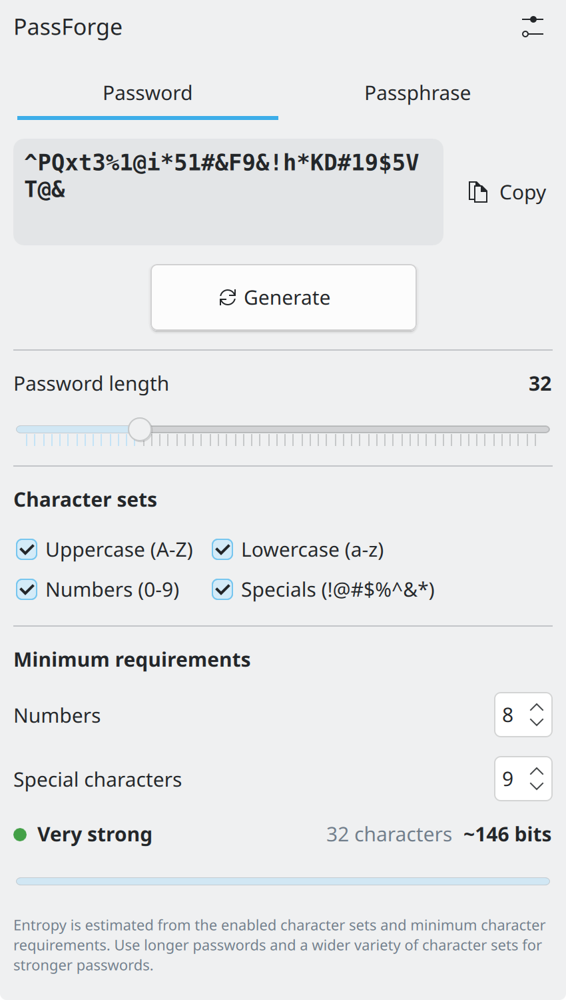
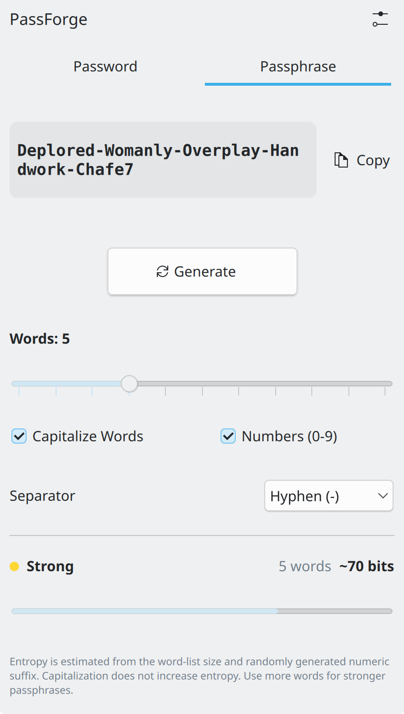
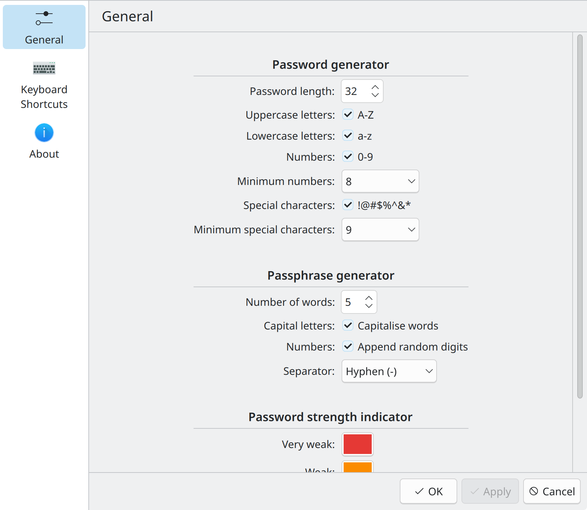

# PassForge — KDE Plasma 6

**PassForge** is a KDE Plasma 6 widget for generating secure passwords and memorable passphrases. It provides two generators in a native Plasma interface, with flexible character sets, word selection, and configurable generation options.

PassForge uses Qt's system-backed cryptographic random number generator through a small C++ QML module named `OpenSquares.PassForge`.

<p align="center">
  
  
  
</p>

## Features

### Password Generator

- Generate passwords with configurable lengths from 5 to 128 characters.
- Choose from four character sets:
  - Uppercase letters (`A-Z`)
  - Lowercase letters (`a-z`)
  - Numbers (`0-9`)
  - Special characters (`!@#$%^&*`)
- Configure minimum numbers and special characters.
- Randomize character positions to distribute required characters throughout the password.
- View estimated entropy and a visual password-strength indicator.
- Scroll through longer generated passwords.
- Copy generated passwords to the clipboard.

### Passphrase Generator

- Generate passphrases using 2–12 randomly selected words.
- Optionally capitalize the first letter of each word.
- Optionally append a random digit (0–9) to one randomly selected word.
- Choose a word separator: hyphen (`-`), underscore (`_`), period (`.`), space, or none.
- View estimated entropy and a visual password-strength indicator.
- Copy generated passphrases to the clipboard.

### Native Plasma Integration

- Designed for KDE Plasma 6.
- Integrates directly into the desktop or panel as a Plasma widget.
- Persistent settings across sessions.
- Configurable through the native Plasma settings interface.

## Security and Randomness

PassForge uses Qt's `QRandomGenerator::system()` through its C++ QML module, `OpenSquares.PassForge`. This provides access to the operating system's cryptographically secure random number source.

- Password characters are selected using uniformly distributed random indices.
- Required character types are generated separately to satisfy configured minimums.
- A Fisher–Yates shuffle randomizes the final password character positions.
- Passphrase words are selected independently from a bundled dictionary containing 7,776 words, sourced from the [Electronic Frontier Foundation (EFF) Dice-Generated Passphrase Wordlist](https://www.eff.org/files/2016/07/18/eff_large_wordlist.txt).
- Optional numeric suffixes use a random digit and a randomly selected word position.

PassForge also provides theoretical entropy estimates to help understand the strength of generated credentials. These estimates are not formal security guarantees and do not constitute an independent security audit.

**Keep generated passwords and passphrases private.** Clipboard managers may retain copied credentials in clipboard history.

## Entropy Estimates

PassForge provides theoretical entropy estimates to help users understand the strength of generated passwords and passphrases.

### Passphrases

The base entropy estimate is calculated from the number of independently selected words and the size of the wordlist:

`wordCount × log₂(wordListSize)`

PassForge uses a bundled 7,776-word dictionary sourced from the [Electronic Frontier Foundation (EFF) Dice-Generated Passphrase Wordlist](https://www.eff.org/files/2016/07/18/eff_large_wordlist.txt).

When numeric suffixes are enabled, the estimate additionally accounts for the random digit (10 possible values) and the randomly selected word position to which it is appended.

### Passwords

For passwords, the entropy estimate considers:

- The total number of enabled characters across the selected character sets.
- The configured password length.
- The minimum number of required numeric and special characters.

This accounts for the constraints placed on password generation rather than assuming every character can be selected from the entire enabled character pool without restrictions.

These figures are theoretical estimates based on the generator's selection process, not formal security guarantees. They do not constitute an independent security audit of the generator.

## Download and Installation

### Download

Get the latest stable PassForge release from GitHub:

**[Download PassForge — Latest Release](https://github.com/aaryanvangari/passforge/releases/latest)**

Download the `.deb` package for your system from the latest release assets.

### Install

On Debian or Ubuntu-based distributions, install the downloaded package using:

```bash
sudo apt install ./passforge_*_amd64.deb
```

After installation, open Plasma's widget browser, search for **PassForge**, and add it to your desktop or panel.

## Development

Interested in building PassForge from source or working on the project?

See [DEVELOPMENT.md](./DEVELOPMENT.md) for the development environment, build instructions, testing workflow, packaging, and release process.

## License

Copyright (c) Aaryan Vangari

PassForge is licensed under the **GNU General Public License v3.0 or later**.

See [LICENSE](./LICENSE) for the full license text.

## Support and Bug Reports

For bug reports, feature requests, and questions, visit the [PassForge GitHub Issues](https://github.com/aaryanvangari/passforge/issues) page.

**Project website:** [passforge.opensquares.in](https://passforge.opensquares.in)